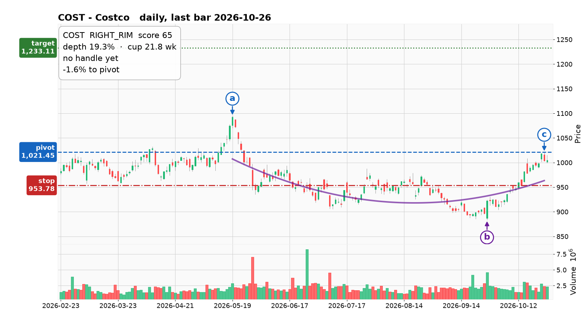
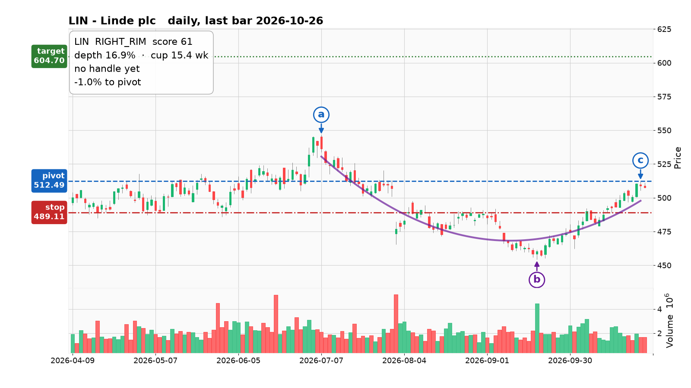
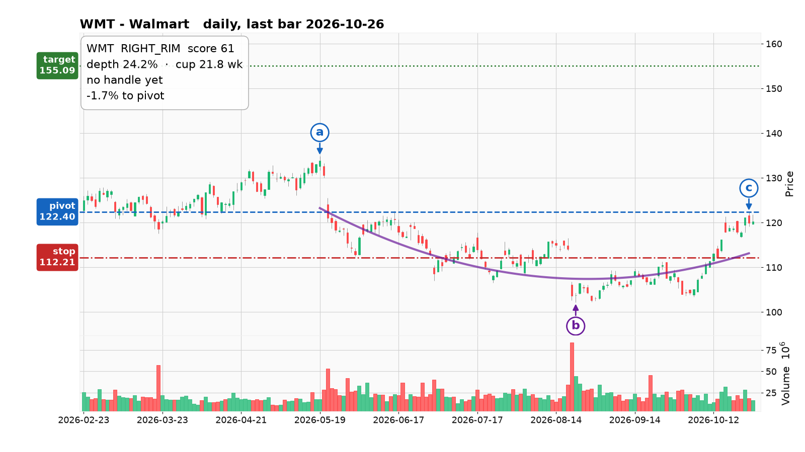
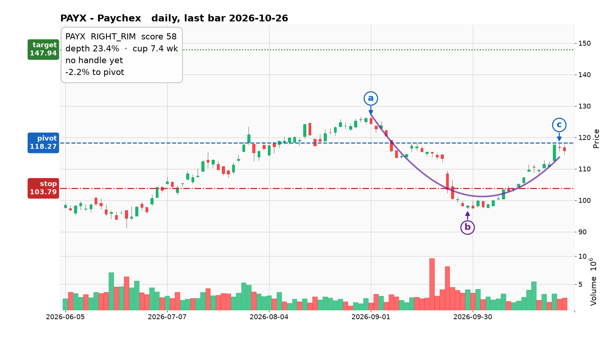
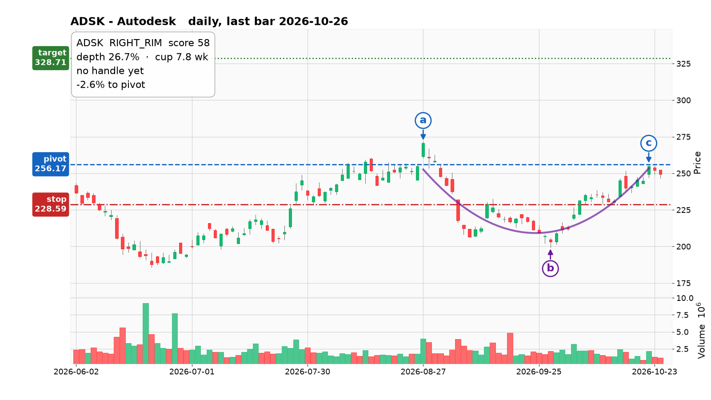
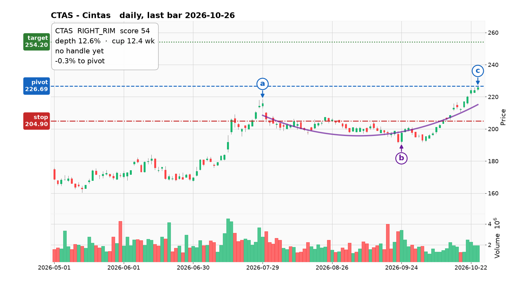
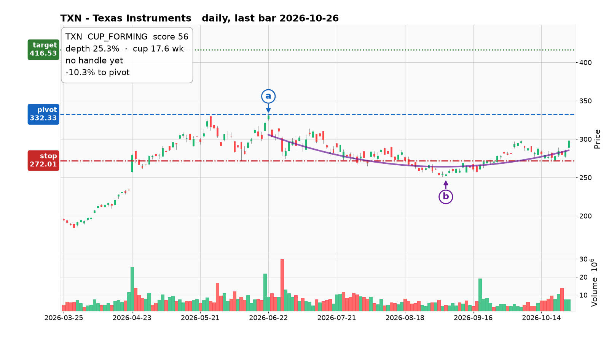

# Cup-and-handle scan: 2026-10-26

Last session **2026-10-26** (New York) · run 2026-10-27 19:34 IST · config `config.yaml`

Scanned 99 of 101 · skipped 2 · BREAKOUT 0 · NEAR_PIVOT 0 · HANDLE_FORMING 0 · RIGHT_RIM 6 · CUP_FORMING 1

**QQQ** 712.20 · SMA50 725.08 (below) · SMA200 676.57 (above)

Key config values

| Setting | Value |
|---|---|
| Prior uptrend | >= 30% within 189 bars |
| Cup length | 30..325 bars |
| Cup depth | 12..35% |
| Rim ratio c/a | 0.9..1.05 |
| Round bottom | >= 0.4 of closes in bottom 35% |
| Handle length | 5..30 bars, <= 0.5 x cup |
| Handle depth | 2..12%, low above 50% of cup |
| Near pivot | within 5% |
| Breakout | <= 10 bars old, volume >= 1.4x 50-day avg |
| Target method | absolute |
| History | 3 years daily |

## Summary

| Ticker | Company | Stage | Score | Close | Pivot | % to pivot | Cup depth % | Cup wks | Handle % | Handle days | Stop | Target | Vol ratio | Flags | 
|---|---|---|---|---|---|---|---|---|---|---|---|---|---|---|
| COST | Costco | RIGHT_RIM | 65.3 | 1,005.16 | 1,021.45 | -1.6 | 19.3 | 21.8 | – | – | 953.78 | 1,233.11 | – | rim_unconfirmed | 
| LIN | Linde plc | RIGHT_RIM | 61.0 | 507.56 | 512.49 | -1.0 | 16.9 | 15.4 | – | – | 489.11 | 604.70 | – | rim_unconfirmed | 
| WMT | Walmart | RIGHT_RIM | 60.9 | 120.29 | 122.40 | -1.7 | 24.2 | 21.8 | – | – | 112.21 | 155.09 | – | rim_unconfirmed | 
| PAYX | Paychex | RIGHT_RIM | 58.2 | 115.70 | 118.27 | -2.2 | 23.4 | 7.4 | – | – | 103.79 | 147.94 | – | rim_unconfirmed | 
| ADSK | Autodesk | RIGHT_RIM | 57.9 | 249.45 | 256.17 | -2.6 | 26.7 | 7.8 | – | – | 228.59 | 328.71 | – | rim_unconfirmed | 
| CTAS | Cintas | RIGHT_RIM | 54.0 | 225.93 | 226.69 | -0.3 | 12.6 | 12.4 | – | – | 204.90 | 254.20 | – | rim_unconfirmed | 
| TXN | Texas Instruments | CUP_FORMING | 56.0 | 298.12 | 332.33 | -10.3 | 25.3 | 17.6 | – | – | 272.01 | 416.53 | – |  | 

## BREAKOUT (0)

_Closed above the pivot within the last few bars and has not failed._

None.

## NEAR_PIVOT (0)

_Cup and handle complete; price is just under the pivot._

None.

## HANDLE_FORMING (0)

_Cup complete; the handle is still short or price is well under the pivot._

None.

## RIGHT_RIM (6)

_Cup complete up to the right rim; no handle pullback yet._

### COST · Costco · score 65.3 · rim_unconfirmed

Close 1,005.16 · pivot 1,021.45 (-1.6%) · stop 953.78 · target 1,233.11 · a 2026-05-19 · b 2026-09-25 · c 2026-10-23

Rules

| Status | Rule | Measured | Threshold |
|---|---|---|---|
| PASS | left_rim_dominance | high[a] 1094.76 vs prior max 1078.12 | highest high of prior 60 bars |
| PASS | prior_uptrend | 30.3% | >= 30% over 189 bars before a |
| PASS | cup_length | 109 bars (c - a) | 30 bars .. 325 bars |
| PASS | cup_depth | 19.3% | 12% .. 35% |
| PASS | rim_ratio | 0.933 (high[c]/high[a]) | 0.9 .. 1.05 |
| PASS | no_interior_peak | interior max 1088.01 vs rims 1094.76 | <= max(high[a], high[c]) |
| PASS | bottom_position | 0.817 ((b-a)/(c-a)) | 0.15 .. 0.85 |
| PASS | u_shape | 0.682 of closes in bottom 35% of depth | >= 0.4 |
| pass | handle_depth_min | 2.2% | >= 2% |
| PASS | handle_depth_max | 2.2% | <= 12% |
| PASS | handle_position | 0.548 of cup depth above low[b] | >= 0.5 |
| PASS | handle_length_max | 1 bars | <= 30 bars (min of 30, 0.5 x cup) |
| fail | handle_length_min | 1 bars | >= 5 bars |

Score components: u_shape 1.0x25, symmetry 0.31x10, depth 1.0x10, handle 0.5x20, volume 0.5x15, trend 0.5x10, rel_strength 0.47x10

### LIN · Linde plc · score 61.0 · rim_unconfirmed

Close 507.56 · pivot 512.49 (-1.0%) · stop 489.11 · target 604.70 · a 2026-07-07 · b 2026-09-18 · c 2026-10-23

Rules

| Status | Rule | Measured | Threshold |
|---|---|---|---|
| PASS | left_rim_dominance | high[a] 546.40 vs prior max 545.42 | highest high of prior 60 bars |
| PASS | prior_uptrend | 42.3% | >= 30% over 189 bars before a |
| PASS | cup_length | 77 bars (c - a) | 30 bars .. 325 bars |
| PASS | cup_depth | 16.9% | 12% .. 35% |
| PASS | rim_ratio | 0.938 (high[c]/high[a]) | 0.9 .. 1.05 |
| PASS | no_interior_peak | interior max 535.29 vs rims 546.40 | <= max(high[a], high[c]) |
| PASS | bottom_position | 0.675 ((b-a)/(c-a)) | 0.15 .. 0.85 |
| PASS | u_shape | 0.513 of closes in bottom 35% of depth | >= 0.4 |
| fail | handle_depth_min | 1.0% | >= 2% |
| PASS | handle_depth_max | 1.0% | <= 12% |
| PASS | handle_position | 0.574 of cup depth above low[b] | >= 0.5 |
| PASS | handle_length_max | 1 bars | <= 30 bars (min of 30, 0.5 x cup) |
| fail | handle_length_min | 1 bars | >= 5 bars |

Score components: u_shape 0.81x25, symmetry 0.36x10, depth 1.0x10, handle 0.5x20, volume 0.5x15, trend 0.5x10, rel_strength 0.46x10

### WMT · Walmart · score 60.9 · rim_unconfirmed

Close 120.29 · pivot 122.40 (-1.7%) · stop 112.21 · target 155.09 · a 2026-05-19 · b 2026-08-21 · c 2026-10-23

Rules

| Status | Rule | Measured | Threshold |
|---|---|---|---|
| PASS | left_rim_dominance | high[a] 134.84 vs prior max 133.63 | highest high of prior 60 bars |
| PASS | prior_uptrend | 42.5% | >= 30% over 189 bars before a |
| PASS | cup_length | 109 bars (c - a) | 30 bars .. 325 bars |
| PASS | cup_depth | 24.2% | 12% .. 35% |
| PASS | rim_ratio | 0.908 (high[c]/high[a]) | 0.9 .. 1.05 |
| PASS | no_interior_peak | interior max 133.33 vs rims 134.84 | <= max(high[a], high[c]) |
| PASS | bottom_position | 0.596 ((b-a)/(c-a)) | 0.15 .. 0.85 |
| PASS | u_shape | 0.582 of closes in bottom 35% of depth | >= 0.4 |
| pass | handle_depth_min | 2.3% | >= 2% |
| PASS | handle_depth_max | 2.3% | <= 12% |
| PASS | handle_position | 0.533 of cup depth above low[b] | >= 0.5 |
| PASS | handle_length_max | 1 bars | <= 30 bars (min of 30, 0.5 x cup) |
| fail | handle_length_min | 1 bars | >= 5 bars |

Score components: u_shape 1.0x25, symmetry 0.03x10, depth 1.0x10, handle 0.5x20, volume 0.5x15, trend 0.5x10, rel_strength 0.31x10

### PAYX · Paychex · score 58.2 · rim_unconfirmed

Close 115.70 · pivot 118.27 (-2.2%) · stop 103.79 · target 147.94 · a 2026-09-01 · b 2026-09-29 · c 2026-10-23

Rules

| Status | Rule | Measured | Threshold |
|---|---|---|---|
| PASS | left_rim_dominance | high[a] 126.69 vs prior max 126.63 | highest high of prior 60 bars |
| PASS | prior_uptrend | 53.3% | >= 30% over 189 bars before a |
| PASS | cup_length | 37 bars (c - a) | 30 bars .. 325 bars |
| PASS | cup_depth | 23.4% | 12% .. 35% |
| PASS | rim_ratio | 0.934 (high[c]/high[a]) | 0.9 .. 1.05 |
| PASS | no_interior_peak | interior max 125.18 vs rims 126.69 | <= max(high[a], high[c]) |
| PASS | bottom_position | 0.514 ((b-a)/(c-a)) | 0.15 .. 0.85 |
| PASS | u_shape | 0.421 of closes in bottom 35% of depth | >= 0.4 |
| pass | handle_depth_min | 3.2% | >= 2% |
| PASS | handle_depth_max | 3.2% | <= 12% |
| PASS | handle_position | 0.590 of cup depth above low[b] | >= 0.5 |
| PASS | handle_length_max | 1 bars | <= 18 bars (min of 30, 0.5 x cup) |
| fail | handle_length_min | 1 bars | >= 5 bars |

Score components: u_shape 0.36x25, symmetry 0.31x10, depth 1.0x10, handle 0.5x20, volume 0.5x15, trend 1.0x10, rel_strength 0.87x10

### ADSK · Autodesk · score 57.9 · rim_unconfirmed

Close 249.45 · pivot 256.17 (-2.6%) · stop 228.59 · target 328.71 · a 2026-08-27 · b 2026-09-29 · c 2026-10-22

Rules

| Status | Rule | Measured | Threshold |
|---|---|---|---|
| PASS | left_rim_dominance | high[a] 271.72 vs prior max 260.74 | highest high of prior 60 bars |
| PASS | prior_uptrend | 46.5% | >= 30% over 189 bars before a |
| PASS | cup_length | 39 bars (c - a) | 30 bars .. 325 bars |
| PASS | cup_depth | 26.7% | 12% .. 35% |
| PASS | rim_ratio | 0.943 (high[c]/high[a]) | 0.9 .. 1.05 |
| PASS | no_interior_peak | interior max 267.00 vs rims 271.72 | <= max(high[a], high[c]) |
| PASS | bottom_position | 0.564 ((b-a)/(c-a)) | 0.15 .. 0.85 |
| PASS | u_shape | 0.475 of closes in bottom 35% of depth | >= 0.4 |
| pass | handle_depth_min | 3.8% | >= 2% |
| PASS | handle_depth_max | 3.8% | <= 12% |
| PASS | handle_position | 0.653 of cup depth above low[b] | >= 0.5 |
| PASS | handle_length_max | 2 bars | <= 20 bars (min of 30, 0.5 x cup) |
| fail | handle_length_min | 2 bars | >= 5 bars |

Score components: u_shape 0.62x25, symmetry 0.41x10, depth 1.0x10, handle 0.5x20, volume 0.5x15, trend 0.5x10, rel_strength 0.57x10

### CTAS · Cintas · score 54.0 · rim_unconfirmed

Close 225.93 · pivot 226.69 (-0.3%) · stop 204.90 · target 254.20 · a 2026-07-29 · b 2026-09-24 · c 2026-10-26

Rules

| Status | Rule | Measured | Threshold |
|---|---|---|---|
| PASS | left_rim_dominance | high[a] 218.60 vs prior max 218.07 | highest high of prior 60 bars |
| PASS | prior_uptrend | 36.4% | >= 30% over 189 bars before a |
| PASS | cup_length | 62 bars (c - a) | 30 bars .. 325 bars |
| PASS | cup_depth | 12.6% | 12% .. 35% |
| PASS | rim_ratio | 1.037 (high[c]/high[a]) | 0.9 .. 1.05 |
| PASS | no_interior_peak | interior max 225.79 vs rims 226.69 | <= max(high[a], high[c]) |
| PASS | bottom_position | 0.645 ((b-a)/(c-a)) | 0.15 .. 0.85 |
| PASS | u_shape | 0.429 of closes in bottom 35% of depth | >= 0.4 |
| fail | handle_depth_min | no handle bars | >= 2% |
| n/a | handle_depth_max | no handle bars | <= 12% |
| n/a | handle_position | no handle bars | >= 0.5 |
| PASS | handle_length_max | 0 bars | <= 30 bars (min of 30, 0.5 x cup) |
| fail | handle_length_min | 0 bars | >= 5 bars |

Score components: u_shape 0.39x25, symmetry 0.64x10, depth 0.2x10, handle 0.5x20, volume 0.5x15, trend 1.0x10, rel_strength 0.84x10

## CUP_FORMING (1)

_Left side and bottom in place; price is climbing the right side._

### TXN · Texas Instruments · score 56.0

Close 298.12 · pivot 332.33 (-10.3%) · stop 272.01 · target 416.53 · a 2026-06-22 · b 2026-09-03

Rules

| Status | Rule | Measured | Threshold |
|---|---|---|---|
| PASS | left_rim_dominance | high[a] 332.33 vs prior max 329.82 | highest high of prior 60 bars |
| PASS | prior_uptrend | 121.3% | >= 30% over 189 bars before a |
| PASS | forming_bottom_confirmed | bottom 36 bars before T | >= 5 bars before T |
| PASS | forming_no_higher_high | max high after a 314.98 vs high[a] 332.33 | <= high[a] |
| PASS | cup_length | 88 bars (T - a) | 30 bars .. 325 bars |
| PASS | cup_depth | 25.3% | 12% .. 35% |
| PASS | forming_recovery | 0.594 of depth recovered | >= 0.5 |
| PASS | forming_below_rim | close 0.897 x high[a] | < 0.9 x high[a] |
| PASS | forming_no_right_rim | max high since b 0.900 x high[a] | < 0.9 x high[a] |
| PASS | u_shape | 0.404 of closes in bottom 35% of depth | >= 0.4 |

Score components: u_shape 0.27x25, symmetry 0.5x10, depth 1.0x10, handle 0.5x20, volume 0.5x15, trend 1.0x10, rel_strength 0.67x10

## Near misses

Best candidate per ticker that failed exactly one rule (tickers without a result).

| Ticker | Company | Would be | Score | Failed rule | Measured | Threshold | a | c |
|---|---|---|---|---|---|---|---|---|
| WDAY | Workday, Inc. | RIGHT_RIM | 79.3 | left_rim_dominance | high[a] 211.83 vs prior max 227.49 | highest high of prior 60 bars | 2026-09-03 | 2026-10-26 |
| ROP | Roper Technologies | RIGHT_RIM | 75.4 | rim_ratio | 1.052 (high[c]/high[a]) | 0.9 .. 1.05 | 2026-09-03 | 2026-10-26 |
| MSFT | Microsoft | NEAR_PIVOT | 73.2 | cup_depth | 36.5% | 12% .. 35% | 2025-10-28 | 2026-10-13 |
| ADI | Analog Devices | NEAR_PIVOT | 72.5 | handle_position | 0.352 of cup depth above low[b] | >= 0.5 | 2026-06-22 | 2026-10-06 |
| ADBE | Adobe Inc. | RIGHT_RIM | 70.6 | handle_position | 0.421 of cup depth above low[b] | >= 0.5 | 2026-09-01 | 2026-10-22 |
| SHOP | Shopify | HANDLE_FORMING | 70.5 | cup_depth | 48.4% | 12% .. 35% | 2025-10-29 | 2026-10-12 |
| MNST | Monster Beverage | RIGHT_RIM | 70.2 | left_rim_dominance | high[a] 49.24 vs prior max 50.17 | highest high of prior 60 bars | 2026-08-25 | 2026-10-20 |
| FTNT | Fortinet | RIGHT_RIM | 69.6 | cup_length | 9 bars (c - a) | 30 bars .. 325 bars | 2026-10-13 | 2026-10-26 |
| PYPL | PayPal | RIGHT_RIM | 65.7 | handle_position | 0.312 of cup depth above low[b] | >= 0.5 | 2026-08-20 | 2026-10-21 |
| GILD | Gilead Sciences | BREAKOUT | 64.9 | u_shape | 0.381 of closes in bottom 35% of depth | >= 0.4 | 2026-02-11 | 2026-09-23 |

## Skipped tickers

- **HONA**: only 93 bars (< data.min_bars 250)
- **SPCX**: only 94 bars (< data.min_bars 250)
